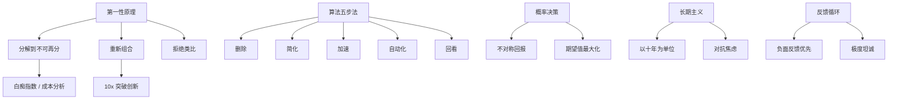

# 马斯克工作方法论与认知体系

> 埃隆·马斯克（Elon Musk）—— Tesla, SpaceX, xAI, Neuralink, The Boring Company 创始人
> 整理时间：2026-04-28

---

## 一、第一性原理（First Principles）

### 核心理念
> "Don't reason by analogy. Boil things down to the most fundamental truths and reason up from there."

**不要用类比思维推理。把事物分解到最基础的真理，然后从那里向上推理。**

### 方法论拆解
1. **分解到不可再分的基础元素**
   - 火箭成本问题 → 分解为：原材料（铝、铜、钛等）的市场价格
   - 电池成本问题 → 分解为：碳、镍、铝等材料成本
   - 关键在于：**大多数人卡在"是什么"层面，马斯克追问"由什么构成"**

2. **重新组合**
   - 知道原材料成本后，重新设计制造方案
   - SpaceX 火箭制造成本 = 传统采购价的 2%，其余 98% 是中间商和传统供应链溢价
   - Tesla 电池组成本从 $600/kWh 降到 $80/kWh

3. **拒绝类比思维**
   - 类比思维："别人都这么做，所以应该这样做"
   - 第一性原理："物理上可能吗？如果可以，怎么做？"
   - **类比是捷径，但也是牢笼。**

### 经典案例
| 问题 | 类比思维 | 第一性原理 | 结果 |
|------|---------|-----------|------|
| 火箭制造成本 | 买俄罗斯二手火箭，$6000万/枚 | 原材料 $200万 → 自己造 | SpaceX 降本 90%+ |
| 电池成本 | 行业 $600/kWh | 材料成本 $80/kWh | Tesla Gigafactory |
| 电动车 | 没人买电动车 | 电动车结构更简单，物理上更优 | Tesla 市值超万亿美元 |

---

## 二、工作方法与效率原则

### 1. 时间块管理（Time Blocking）
- 以 **5分钟为粒度** 安排日程
- 每周工作 80-100 小时（冲刺期）
- 关键原则：**不要开不必要的会**
- 如果会议没有明确 agenda 和预期产出，直接拒绝

### 2. 算法思维（Algorithm）
> "Every process should be treated as an algorithm that can be optimized."

**每个流程都应被视为一个可优化的算法。**

五步检查法（The Algorithm）：
```
第一步：质疑需求 → 删除所有不必要的步骤
第二步：简化优化 → 对剩下的步骤做极致简化
第三步：加速迭代 → 在简化的基础上加速
第四步：自动化 → 最后才考虑自动化
第五步：回看 → 问自己"有什么我漏掉了？"
```

**关键点：** 绝大多数人一上来就想自动化，但真正该做的是先删掉没用的步骤。

### 3. 反馈循环（Feedback Loops）
- **负面反馈 > 正面反馈**
  - "If you're not getting negative feedback, you're not learning fast enough."
  - 主动寻找能指出你错误的人
- **极度坦诚的沟通**
  - 禁止"软话"和"政治正确"的沟通
  - 在 SpaceX 和 Tesla，鼓励任何人直接向 CEO 反馈问题
  - 不需要经过层层汇报

### 4. 快速原型与失败文化
- "If things are not failing, you're not innovating enough."
- **失败不是错误，失败是数据。**
- 猎鹰1号前三次发射全部失败，第四次成功——否则公司破产
- 每次失败都获得了宝贵的数据和认知

### 5. 白痴指数（Idiot Index）
> "The idiot index is the ratio of the total cost of a part to its raw material cost."

**白痴指数 = 零件总成本 ÷ 原材料成本**

- 如果指数 > 10，说明制造过程极其低效
- 特斯拉早期某个零部件成本 $3000，原材料 $15，指数 200
- 解决方案：自己重新设计、自己制造，最终成本降至 $30
- 这是第一性原理在制造中的具体应用

---

## 三、认知框架与决策原则

### 1. 物理学的思维模型
- **第一性原理**（物理学角度）
- **奥卡姆剃刀**：最简单的解释往往最接近真相
- **负熵思维**：对抗熵增，系统需要持续输入能量维持秩序

### 2. 概率决策
- 不要追求"确定"，追求"期望值最大化"
- 做一件事有 10% 的成功率，但成功回报是 100 倍 → 期望值 10 倍，值得做
- **大赌注 + 不对称回报** 是马斯克的决策风格

### 3. 10% 法则
- 如果你认为一件事有 10% 的成功率，但它足够重要，你仍然应该全力以赴
- 参考系：不是"成功概率"，而是"失败代价 vs 成功回报"
- 火箭发射：成功概率低但收益巨大（人类多行星物种）

### 4. 心智模型：全局最优 vs 局部最优
- 大多数人被"局部最优"困住（在现有系统内做到最好）
- 马斯克追求"全局最优"（重新定义整个系统）
- 案例：
  - 局部最优：造更便宜的汽油车
  - 全局最优：造电动车 + 可再生能源 + 电池储能

### 5. 极限思维
- "What's the maximum possible improvement I can achieve?"
- 不是把效率提高 10%，而是 10 倍、100 倍
- **10x 比 10% 更容易实现**（因为 10% 优化在现有框架内，10x 迫使你打破框架）

---

## 四、事务本质的洞察

### 1. 对商业本质的理解
- **产品 > 营销**
  - "Advertising is what you do when your product isn't good enough."
  - Tesla 零广告预算
- **制造 > 设计**
  - "Prototyping is easy. Manufacturing at scale is what's hard."
  - 设计一辆原型车只要几个月，建一条年产 50 万辆的生产线需要数年

### 2. 对问题本质的定义
> "If you can properly frame the problem, you've solved 80% of it."

**正确界定问题 = 解决 80%。**

- 大多数人在解决"错误的问题"
- 问"为什么要做这个？"而不是"怎么做？"
- 如果一个问题你能清楚地表述出来，答案往往已经浮现

### 3. 对时间的认知
- **长期主义**：以十年甚至数十年为单位思考
  - Tesla Master Plan 写于 2006 年，至今仍在执行
  - 火星殖民计划：20-30 年的愿景
- **紧急 ≠ 重要**
  - 区分"紧急但不重要"和"重要但不紧急"
  - 绝大多数时间应该花在后者

### 4. 对风险的认知
- "Starting a company is like eating glass and staring into the abyss."
- **真正的风险不是失败，是不敢尝试**
- 特斯拉 2008 年距离破产只差 24 小时
- SpaceX 三次发射失败后面临破产
- 但他认为：如果人类文明不能成为多行星物种，那才是最大的风险

### 5. 对人才的判断
> "If someone is amazing, you should hire them. If not, you should fire them. It's that simple."

- **能力 > 经验**
- 不问"你做过什么？"而问"你解决过什么难题？"
- 杜绝"履历好看但不出活"的人

### 6. 对读物的认知
- "All of that information is free. You just have to read books."
- 马斯克通过阅读自学火箭科学和汽车工程
- 推荐阅读：
  - 《银河系漫游指南》—— 影响了他提出问题的方式
  - 《本杰明·富兰克林传》
  - 《爱因斯坦传》
  - 《从0到1》
  - 物理学和工程学教材

---

## 五、个人工作习惯

### 经典语录
| 语录 | 解读 |
|------|------|
| "Work like hell. I mean, you just have to put in 80 to 100 hour weeks." | 创业没有捷径 |
| "The first step is to establish that something is possible; then probability will occur." | 先确定"物理上可行"，再考虑"概率" |
| "If you wake up in the morning and think the future is going to be better, it is a bright day." | 乐观主义是驱动力 |
| "Persistence is very important. You should not give up unless you are forced to give up." | 除非被强制放弃，否则不要放弃 |
| "Anyone who doesn't think I'm insane is clearly not paying attention." | 保持清醒的自嘲 |

### 实际工作规则
1. **电子邮件优先**
   - 用邮件而非即时消息
   - 回复要点明确，不加客套
   - 邮件能追溯、可搜索、信息密度高

2. **不搞形式主义**
   - 没有独立办公室（所有人在同一开放空间工作）
   - 没有层级汇报的官僚习气
   - "Title is a form of hierarchy. Hierarchy kills truth."

3. **极致细节管理**
   - 亲自检查工厂生产线最微小的问题
   - 参与火箭设计的具体工程讨论
   - "CEO should be in the room where the hard problems are being solved."

4. **睡眠与恢复**
   - 虽然推崇高强度工作，但也承认睡眠不足会影响决策质量
   - 后来改进了睡眠习惯，强调 6-7 小时睡眠
   - "You can't solve hard problems when you're exhausted."

---

## 六、核心模型总结



---

## 七、实用行动清单

| 领域 | 行动建议 |
|------|---------|
| **解决问题** | 遇到问题先问"物理上可能吗？" → 分解到基础元素 → 重新组合 |
| **优化流程** | 先删后优化 → 再加速 → 最后自动化 |
| **团队管理** | 鼓励直接反馈 → 消除层级 → 能力>经验 |
| **个人成长** | 读基础书（物理/工程/传记）→ 建立第一性原理 → 忍受不确定性 |
| **决策原则** | 期望值最大化 → 不对称回报 → 全局最优 |
| **工作习惯** | 5分钟时间块 → 邮件优先 → 参与核心难题 |

---

## 八、推荐扩展阅读

### 书籍
1. 《Elon Musk》- Ashlee Vance（传记）
2. 《埃隆·马斯克传》- Walter Isaacson（2023年新传，最全面）
3. 《第一性原理》- 各种解读版本
4. 《Zero to One》- Peter Thiel（与马斯克思想有交集）

### 关键采访
1. 2013 年 SXSW 采访 —— 第一次系统阐述第一性原理
2. 2017 年 TED 访谈 —— 火星殖民与 AI 风险
3. Lex Fridman 多次访谈 —— 深度技术讨论
4. 2023 年 DealBook 峰会 —— AI、X、未来预测

---

> **最后一句马斯克的话：**
> "I'd rather be optimistic and wrong than pessimistic and right."

